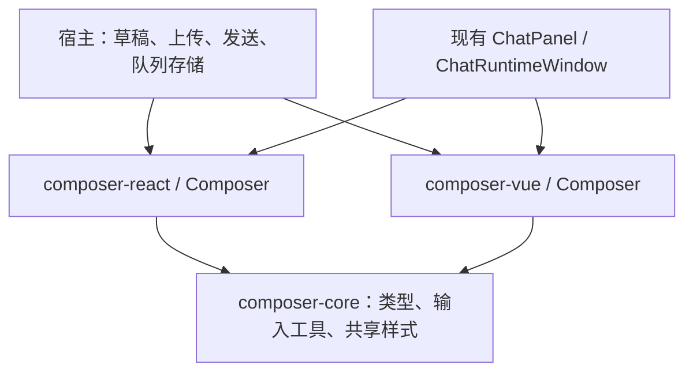
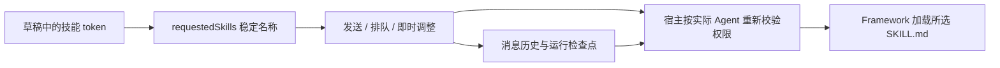

# 独立消息输入区

`composer-react` 和 `composer-vue` 导出 `Composer`，两端依赖 `composer-core` 的类型、输入工具与共享样式。可以仅安装所需的渲染包；它们不依赖 chat 或 A2UI。使用时显式导入渲染包的 `styles.css`，无需配置 Tailwind。



## 接入与能力

React 示例见 [composer-react](../packages/composer-react/README.md)，Vue 示例见 [composer-vue](../packages/composer-vue/README.md)。`draft` 始终受宿主控制，组件通过 `onDraftChange` / `draft-change` 更新草稿。

| 能力 | 参数或事件 |
| --- | --- |
| 普通发送 | `onSend("send")` / `send`；Enter 或发送按钮 |
| 运行中排队 | `sending`、`runningSubmitModes: ["queue"]`；Enter 发出 `queue` |
| 即时调整 | `runningSubmitModes` 包含 `steer`；⌘/Ctrl+Enter 发出 `steer` |
| 停止 | `onStop` / `stop`；`showStop` 控制按钮 |
| 换行与输入法 | Shift+Enter 在光标位置插入换行，IME 确认不发送 |
| 命令与技能 | `inputSuggestions`，`/` 查询命令和技能，`$` 只查询技能；上下键、Enter 和 Escape 操作菜单 |
| 技能标签 | `displayName`，回退到 `description`、`name`；草稿保留 `$name` |
| 队列 | `queuedMessages`、`onEditQueuedMessage` / `edit-queued-message`、`onRemoveQueuedMessage` / `remove-queued-message` |
| 附件选择 | `showAttachmentControl`、`onAttachFile`、`attachmentUploadPending` |
| 图片粘贴 | `onPasteAttachment`，未提供回调时保留浏览器默认粘贴 |
| 附件预览与移除 | `pendingAttachments`、`attachmentDownloader`、`onRemoveAttachment` / `remove-attachment`；下载图片的临时 URL 在替换/卸载时释放 |
| 扩展区 | React 的 `composerHeader`、`footerAddon`；Vue 同名插槽，头部也支持组件 prop |
| 禁用与文案 | `disabledInput`、`sendDisabled`、`queueDisabled`、`steerDisabled`；占位、按钮、队列、建议与附件文案可覆盖 |

上传、鉴权、错误处理、排队持久化和会话切换由宿主管理。组件提供输入与展示，回调可以接入任意服务。React 保留没有 `onStop` 时调用 `onSend("send")` 的原有回退；Vue 通过 `stop` 事件交给宿主。

原有 `ChatPanel`、`ChatWindow`、`ChatRuntimeWindow` 已使用独立 Composer。旧的 chat 类型名称与原有 props/事件继续可用；运行窗口继续负责 adapter 上传与发送，并把附件和运行状态传给输入区。附件与自定义头部可以同时显示。

## 显式技能选择

`skillSuggestionTriggers: ["$"]` 可将 `/` 保留给指令，`$` 显示技能建议。未配置时保留两种触发方式。

独立使用 Composer 时，宿主通过 `requestedSkillsFromDraft(draft, inputSuggestions, previousSelection)` 从已选择的 `$name` 提取稳定技能名；`previousSelection` 用于排队编辑或建议列表刷新后保留已有选择。删除 token 会同时移除选择，普通文字中的未知名称不会自动激活技能。支持中文等 Unicode 技能名称。

ChatRuntimeWindow 自动在 `SendChatMessageInput.requestedSkills` 中携带选择，普通发送、排队、即时调整和排队编辑使用同一字段。结构化历史的 `HistoryMessage.requestedSkills` 会映射到消息对象，编辑历史消息时也会恢复技能选择，并在再次发送时重新校验。建议项只负责补全；指令的执行由宿主提供。Tron 当前支持 `/goal <目标>`；已有未完成目标时更新其目标内容，暂停或阻塞的目标会恢复执行。



Tron 的 Framework Agent 使用 `AgentSelection.skills_from_host`，每轮必须提供可信的 `SkillAccess`；默认静态技能配置仍与宿主权限取交集。

选择不授予技能或工具权限。宿主必须在提交和执行时检查可用性；Framework 在恢复时重新加载并校验，资源仍通过原有技能资源工具访问。

## 主题

两端共用 `packages/composer-core/src/styles.css`。根挂点为 `data-theme-part="composer"` / `data-theme-anchor="composer"`，textarea 保留 `chat-input` 挂点。样式只作用于输入区，不加载产品皮肤或设置全局颜色；直接继承宿主的 `--agent-ui-chat-*`、`--agent-ui-*` 和 `--color-*` 覆盖。无主题时使用原有默认值。减弱动画偏好关闭光标闪烁。

外观参数清单与默认值见 [输入区主题变量](composer-theme.md)，机器索引见 [composer-theme-tokens.json](composer-theme-tokens.json)。

## 本地验证

```sh
npm run check
npm run dev --workspace=@eliteforge/agent-ui-composer-react -- --port 5186
npm run dev --workspace=@eliteforge/agent-ui-composer-vue -- --port 5187
```

两页都直接导入独立 Composer，提供浅色/深色/自定义主题、运行状态、禁用、窄屏、附件和事件日志。`tests/composer-browser.mjs` 的 `verifyComposer(page)` 可通过 Playwright CLI `run-code` 对任意一页执行相同检查。
